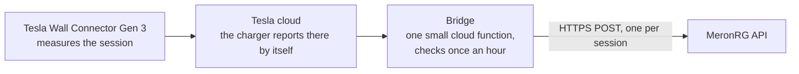

# Wall Connector meter bridge

A resident's own Tesla Wall Connector Gen 3 reports every charging session to the building's
charging operator (MeronRG), so the operator can meter and bill it like any other charge point.

**Live demo (simulated charger):** https://wc-meter-bridge.gunr1984.workers.dev

## How it works



- Nothing is installed on the building's network, and nothing connects in to it. The only
  traffic toward MeronRG is an outbound HTTPS request to an address MeronRG chooses.
- The bridge is a few hundred lines of code in this repository, running on Cloudflare Workers.

## What MeronRG receives

One message per completed charging session:

```http
POST /v1/readings
Authorization: Bearer <key issued by MeronRG>
Idempotency-Key: WC3-0001-000005
Content-Type: application/json

{
  "reading_id": "WC3-0001-000005",
  "charger_id": "WC3-0001",
  "session": {
    "started_at": "2026-11-12T17:00:00.000Z",
    "ended_at": "2026-11-12T19:03:00.000Z",
    "energy_wh": 15785
  },
  "meter_total_wh": 104397,
  "source": "tesla-fleet-api"
}
```

| Field | Meaning |
|---|---|
| `reading_id` | Unique per session. A retry repeats the same value. |
| `charger_id` | Whatever identifier MeronRG assigns to this charger or customer. |
| `session.started_at`, `session.ended_at` | Session start and end, UTC, ISO 8601. |
| `session.energy_wh` | Energy delivered in the session, watt-hours. |
| `meter_total_wh` | Running total of all sessions reported so far, this one included. Works as a meter register: the difference between two readings is the consumption between them. |
| `source` | Where the figures came from. |

The full specification is in [`docs/openapi.yaml`](docs/openapi.yaml).

**Delivery rules**

- Any `2xx` answer means the session is accepted.
- On any other answer, or no answer, the same message with the same `reading_id` is sent
  again every hour until it is accepted. Sessions are always delivered in order.
- If a repeat arrives, ignore it (same `reading_id`). Nothing is lost and nothing is counted twice.
- A session is reported within about an hour of its end.

## What we need from MeronRG

1. The address to post to (a test address too, if there is one).
2. An API key, or whichever authentication MeronRG prefers.
3. The identifier MeronRG wants for this charger or customer.
4. Any differences from the message above: field names, units (Wh or kWh), time format,
   one message per session or a periodic meter reading. The bridge adapts on its side;
   all of it lives in one short file, [`src/meronrg.ts`](src/meronrg.ts).

If MeronRG would rather collect the data than receive it, the bridge can expose the same
figures at an address MeronRG reads with a key. Same data, opposite direction.

## Where the figures come from

- Energy is measured by the Wall Connector's built-in meter and read from Tesla's own
  service (the Fleet API "charge history" for the charger).
- The Wall Connector's meter is not a certified billing meter. If MeronRG requires one, a
  certified sub-meter on the charger's supply can feed the same message with no change on
  MeronRG's side.
- The charger also keeps a lifetime energy counter that can be read on site, as an
  independent check of the running total.

## Status

| Part | State |
|---|---|
| Bridge, delivery, retries, demo | Working and tested (`npm test`). Runs live at the demo address with a simulated charger. |
| MeronRG side | A stand-in receiver built to the proposal above. Waiting for the real API and key. |
| Tesla side | Written from Tesla's published interface. **Not yet run against a real charger**: the charger is not installed. First-run checks are in [`docs/GO-LIVE.md`](docs/GO-LIVE.md). |

## Try the receiving side

The demo includes a stand-in for the MeronRG endpoint. It checks the key and the fields and
answers as specified (`demo-key` is public on purpose; requests sent this way are checked but not stored):

```bash
curl -X POST https://wc-meter-bridge.gunr1984.workers.dev/mock/meronrg/v1/readings \
  -H "Authorization: Bearer demo-key" \
  -H "Content-Type: application/json" \
  -d '{"reading_id":"WC3-0001-000005","charger_id":"WC3-0001","session":{"started_at":"2026-11-12T17:00:00Z","ended_at":"2026-11-12T19:03:00Z","energy_wh":15785},"meter_total_wh":104397}'
```

## For developers

| File | Job |
|---|---|
| [`src/bridge.ts`](src/bridge.ts) | The hourly job: find new sessions, post each, remember progress. |
| [`src/meronrg.ts`](src/meronrg.ts) | Builds the request to MeronRG. The only file to change for the real API. |
| [`src/tesla.ts`](src/tesla.ts) | Reads completed sessions from Tesla. |
| [`src/demo.ts`](src/demo.ts), [`src/mock.ts`](src/mock.ts) | Simulated charger and stand-in receiver, for the demo. |
| [`src/page.ts`](src/page.ts) | The demo page. |

```bash
npm install
npm test            # unit tests
npm run dev         # local run; open http://localhost:8787/__scheduled to fire the hourly job
npm run deploy      # deploys the demo Worker
```

No secrets live in this repository. Keys are stored as Cloudflare secrets.

---

Simulated data, for a technical proposal. Not operated by or affiliated with MeronRG or Tesla.
